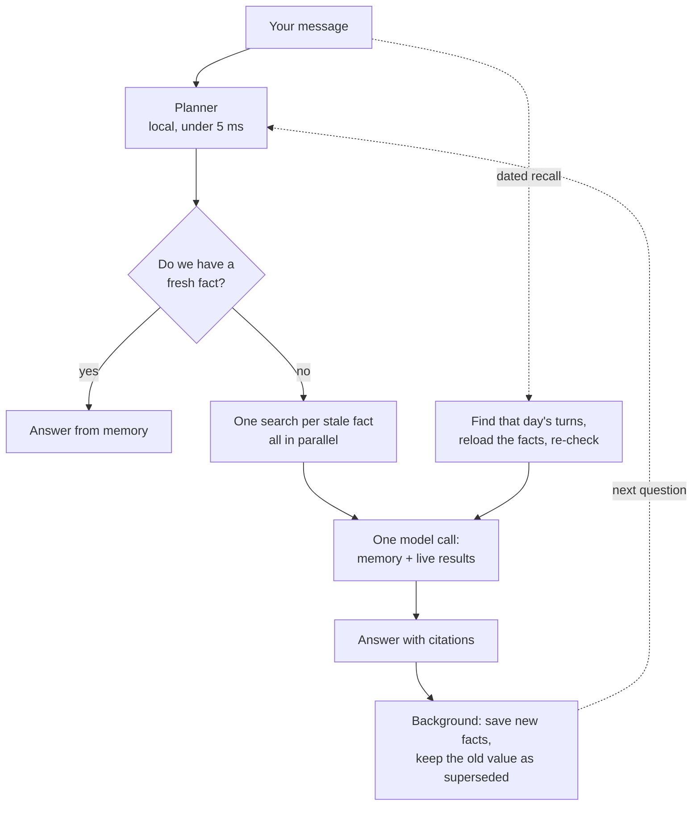

# Minimi

> A chat agent with **one tool** — web search — and a **durable memory of facts**
> that knows when it is out of date.

It remembers what you asked last Tuesday, quotes the number it gave you then, and
checks whether that number is still true before answering. Built for the Minimi
hiring challenge. Full trade-offs are in [DESIGN.md](./DESIGN.md).

**Contents**

1. [What it does](#1-what-it-does)
2. [Architecture](#2-the-60-second-architecture)
3. [Quick start](#3-quick-start)
4. [Environment variables](#4-environment-variables)
5. [Seeded history](#5-seeded-history)
6. [Try the three challenge questions](#6-try-the-three-challenge-questions)
7. [How memory works](#7-how-memory-works)
8. [Project layout](#8-project-layout)
9. [Identity, storage and backups](#9-identity-storage-and-backups)
10. [Known limits and trade-offs](#10-known-limits-and-trade-offs)
11. [Maintenance scripts](#11-maintenance-scripts)
12. [Further reading](#12-further-reading)

---

## 1. What it does

- **Recalls** what was said, and *when* it was said, across conversations.
- **Verifies** anything that can go stale — price, availability, news — with a live
  search, and cites what it found.
- **Says what changed**: old value, new value, how old the old one was.
- **Never pretends**: if it cannot confirm something, it says so instead of guessing.

One message, three behaviours:

| You ask | Mode | What happens |
|---|---|---|
| “What did I ask you on 3 November?” | `RECALL` / `VERIFY` | Finds that day's turns, reloads the facts recorded then, re-checks stale ones |
| “Has Postgres pricing changed since last Tuesday?” | `VERIFY` | Three stale price claims → three parallel searches → one grounded answer |
| “What's the best CRM for a 20-person team?” | `ANSWER` | Pre-searches only if the phrasing is inherently live, then answers |

---

## 2. Architecture

**One-liner:** it is a chat agent whose memory is a ledger of facts with expiry
dates — when a fact goes stale, it checks the live web *before* the model runs.



##  Live Demo :


## 3. Quick start

Requires **Node.js 20+**. No sign-in, no external database, no Docker.

```bash
npm install
cp .env.example .env    # fill in GEMINI_API_KEY and GROQ_API_KEY
npm run dev
```

Open <http://localhost:3000>. Your first visit seeds the dated history described
in [section 5](#5-seeded-history), so you can ask the challenge questions straight
away.

Other commands:

```bash
npm run build     # production build + type check
npx tsc --noEmit  # type check only
npm run lint      # eslint
```

---

## 4. Environment variables

Every key this project understands is in [`.env.example`](./.env.example).

| Variable | Needed? | What it does |
|---|---|---|
| `GEMINI_API_KEY` | one of Gemini/Groq | Primary model. The only provider that can call the search tool. |
| `GEMINI_MODEL` | no | Defaults to `gemini-3.1-flash-lite`. |
| `GEMINI_THINKING` | no | Defaults to `minimal` — zero thought tokens, because the planner does the routing. |
| `GEMINI_GROUNDING` | no | Set `1` to add Google's built-in search. Often quota-blocked on free-tier projects and a blocked request fails wholesale — leave it unset until you confirm it works for your key. |
| `GROQ_API_KEY` | one of Gemini/Groq | Text-only fallback and the post-response fact extraction. |
| `GROQ_MODEL` | no | Defaults to `openai/gpt-oss-20b`. Groq rotates its free catalogue; check `GET https://api.groq.com/openai/v1/models` if it 404s. |
| `WEB_SEARCH_API_KEY` | no | Exa key. Without it the agent still runs — it just says it cannot search live. |
| `WEB_SEARCH_PROVIDER` | no | `exa` (default) or `tavily`. Both adapters are implemented; the other is the fallback. |
| `TAVILY_API_KEY` | no | Optional second search provider. |
| `DATABASE_URL` | no | Defaults to `file:./data/minimi.db`. |
| `OPENROUTER_API_KEY` / `OPENROUTER_MODEL` | no | Present for parity with the brief; **not** wired into the fallback chain. |

With no API key at all the app still starts; a turn returns a clear "all providers
failed" message instead of crashing.

---

## 5. Seeded history

A memory agent is only testable if it has memory, so the first request from a new
browser seeds three **dated** conversations into that browser's own tenant:

| When | Conversation | Facts recorded |
|---|---|---|
| Last Tuesday | Postgres hosting shortlist | `Neon $19/mo`, `Supabase $25/mo`, `Railway $5/mo to start` |
| Last Monday | Five-tool CRM shortlist (20-person team) | One seat price for HubSpot, Salesforce, Pipedrive, Zoho CRM, Freshsales, plus two “shipped something” entries |
| The 3rd of the month | Notion AI pricing for 10 people | `Notion AI $10/member/mo` |

These are **ordinary rows** — same schema, same timestamps, same claims as a real
turn. Nothing is shared between browsers and nothing is faked at answer time. They
are written once, idempotently; deleting them is permanent, and `GET /api/demo`
restores them.

Why seed at all? Because a brand-new database has nothing to recall, so every
question about “last Tuesday” is unanswerable — not because recall is broken, but
because nothing was ever said. Judge the memory, not the emptiness.

---

## 6. Try the three challenge questions

Ask them in a **brand-new chat** — memory is scoped to the tenant, not the
conversation.

```
Last Tuesday I asked you about Postgres hosting. Has any pricing changed since then?

On Monday we shortlisted 5 CRM tools for a 20-person sales team. Has any of them
changed pricing or shipped something big since?

What did I ask you on 3 November? Is your answer still correct today?
```

What you should see:

- the **mode** (`RECALL` / `VERIFY` / `ANSWER`) and the claims it loaded, with
  their age;
- a **status line** during verification — “Checking 7 of them…”;
- an answer that states the old value, the new value, and cites the source;
- a `VERIFY` turn that names *every* subject, including ones it could not confirm.

Measured on a free tier (fresh install, one browser): a 3-claim turn checks 3
sources in parallel and answers in 10.2 s; the 7-claim CRM turn checks 7 in
parallel and answers in 7.8 s (both TTFT). Planner under 5 ms; search 0.3–5.1 s
cold, 1–2 ms cached.

---

## 7. How memory works

Memory is a **claim ledger**, not a chat log:

```sql
entities(id, kind, canonical_name, aliases)
claims(id, entity_id, predicate, value,
       asserted_at, verified_at, source_kind, source_url, message_id,
       status, superseded_by)
freshness_policy(predicate, ttl_hours, verify_policy)
```

| Predicate | TTL | Why |
|---|---|---|
| `price` | 24 h | changes weekly at best |
| `availability` | 12 h | changes fastest |
| `news` | 48 h | “shipped something big” moves in days |
| `version` | 72 h | releases are occasional |
| `ceo`, `address`, `headcount` | 30 d | changes quarterly |
| `release_date`, `user_preference` | never | fixed, or the user is the source of truth |

- **A stale claim is a search trigger.** `now - verified_at > ttl` is a SQL
  predicate, not a model judgement. Each stale claim becomes one query (cap 8),
  dispatched in parallel before the model call.
- **Old values are kept, not overwritten.** A new value supersedes the old one, so
  “it changed since then” stays answerable later.
- **Evidence is grouped per claim.** Results are interleaved two-per-query, so five
  tools are not answered by the first tool's five pages.
- **Recall is date-first.** A named past day is queried by date, not keywords —
  “what did I ask on 3 November” shares almost no words with the answer it wants.
  A future weekday is pulled back a week, so “On Monday” asked on a Friday means
  this week's Monday.
- **Extraction is off the hot path.** After the response is flushed, a small Groq
  call records new facts. A failed extraction loses one fact, never the turn.

---

## 8. Project layout

```
app/
  page.tsx                     streaming NDJSON client: chat, claims, citations
  api/chat/route.ts            POST — streams agent events, schedules extraction
  api/conversations/           list + detail, tenant-scoped
  api/demo/route.ts            restore the seeded history
components/                    chat shell, message, citations, composer, sidebar
lib/
  agent/plan.ts                deterministic planner: RECALL | VERIFY | ANSWER
  agent/claims.ts              entities, freshness, supersede, prompt formatting
  agent/retrieval.ts           chrono date parsing + date-first recall
  agent/run.ts                 orchestrator: parallel search, evidence, model, persist
  agent/extract.ts             post-response fact extraction (Groq)
  providers/                   Gemini (tools, streaming) + Groq (fallback)
  search/                      Exa/Tavily adapters, SQLite cache, tool declaration
  db.ts                        schema, migrations, every query
  auth.ts                      tenant cookie + one-time legacy adoption
  fixtures.ts                  dated seeded history
scripts/                       inspect-db.cjs, backdate-claim.cjs
```

---

## 9. Identity, storage and backups

There is **no sign-in**. The first request mints a UUID in an httpOnly cookie
(`minimi_uid`, one year) and every row is scoped to it.

- Same browser next week → same memory. Restarting the server changes nothing.
- Clearing cookies, another browser, `127.0.0.1` instead of `localhost`, or
  private mode → a new, separately seeded tenant. There is no account recovery.
- Deleting `data/` deletes every conversation, claim and cache entry.

The database is SQLite in **WAL mode**, so a backup is `minimi.db` **plus**
`minimi.db-wal` and `minimi.db-shm`. Copying only the first file gets you an empty
database.

---

## 10. Known limits and trade-offs

- **Identity is a cookie.** Great for a demo, unusable for production without
  accounts. Export/delete and retention controls do not exist yet.
- **Free-tier latency is not stable.** The same prompt measured 6 s and 63 s
  minutes apart; the 63 s case was a Gemini 503 followed by a Groq failover. The
  design removes round trips, not provider variance.
- **Entity matching is exact.** Alias dictionary, case-insensitive, no fuzzy
  matching. A wrong past fact stated confidently is worse than “I don't have that”.
  Consequence: you must name a known subject, a date, or a pronoun that anchors to
  one of them.
- **Subject recall without a date** (“the Postgres thing”) still depends on those
  aliases. A topic → conversation index is the obvious next step.
- **Search is optional.** Without `WEB_SEARCH_API_KEY` the agent answers from
  memory and says that it could not verify — it never fabricates a check.
- **No background verification.** Claims are re-checked when you ask, not on a
  schedule.

---

## 11. Maintenance scripts

```bash
node scripts/inspect-db.cjs        # dump recent entities, claims, metrics, cache
node scripts/backdate-claim.cjs 48 # age every claim by 48 h to exercise VERIFY
```

`turn_metrics` records `mode`, `ttft_ms`, `search_ms`, `tool_ms`, `total_ms`,
`search_source` for every turn — so latency claims can be checked, not trusted.

---

## 12. Further reading

- **[DESIGN.md](./DESIGN.md)** — the full architecture: why a ledger instead of
  embeddings, why routing is deterministic, what was considered and rejected, and
  what another week would add.
- `lib/agent/plan.ts` — the whole planner, about 250 readable lines.
- `lib/agent/run.ts` — the turn lifecycle, top to bottom.
