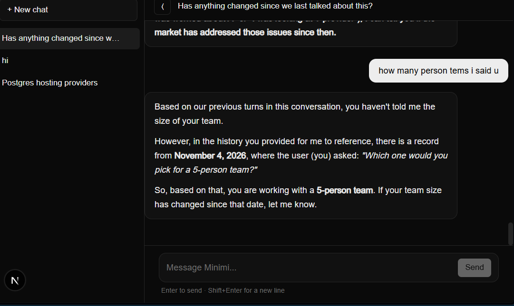
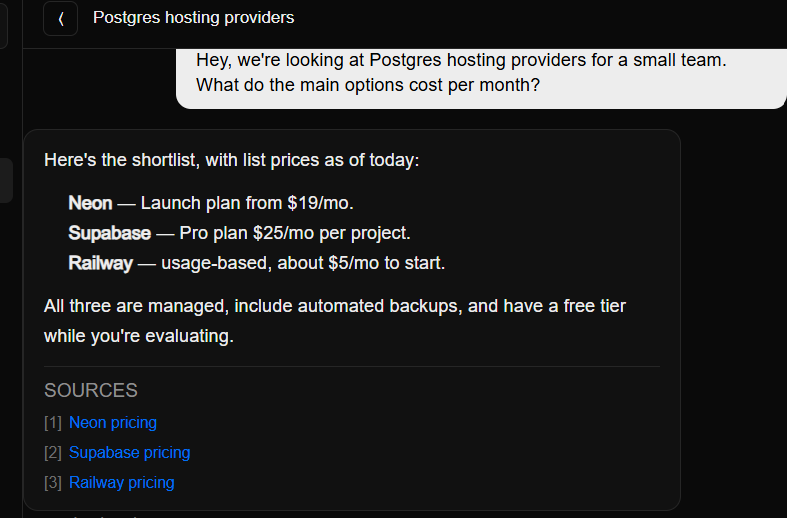

# Minimi

AI chat agent — one tool (web search), persistent SQLite memory, date-based
history recall, old-vs-current comparison, source citations. See
[DESIGN.md](./DESIGN.md) for architecture and [design-system.md](./design-system.md)
for the visual design reference this UI follows.

Live Demo :

#1  
  
#2  



## Setup

```bash
npm install
cp .env.example .env    # fill in GEMINI_API_KEY and GROQ_API_KEY
npm run dev
```

Open http://localhost:3000.

## Env vars

| Var | Required | Notes |
|---|---|---|
| `GEMINI_API_KEY` | one of Gemini/Groq | primary provider, the only one that can call tools |
| `GEMINI_MODEL` | no | defaults to `gemini-3.1-flash-lite` |
| `GEMINI_THINKING` | no | defaults to `minimal` (zero thought tokens; the planner does the routing) |
| `GEMINI_GROUNDING` | no | `1` adds Google's built-in search. Often quota-blocked on free-tier projects, and a blocked request fails wholesale — leave unset until you've confirmed it works for your key |
| `GROQ_API_KEY` | one of Gemini/Groq | text-only fallback provider and post-response claim extraction |
| `GROQ_MODEL` | no | defaults to `openai/gpt-oss-20b`; Groq rotates its free catalogue, so `GET /openai/v1/models` if it 404s |
| `WEB_SEARCH_API_KEY` | no | Exa key. Without it the agent still runs, it just says it can't search live |
| `WEB_SEARCH_PROVIDER` | no | `exa` (default) or `tavily`; both are implemented, the other is used as fallback |
| `TAVILY_API_KEY` | no | second search provider |
| `DATABASE_URL` | no | defaults to `file:./data/minimi.db` |

`OPENROUTER_API_KEY` / `OPENROUTER_MODEL` are in `.env.example` for parity
with the spec but not wired into the fallback chain yet — see DESIGN.md.

No API key configured at all → the app still runs; every chat turn returns
a clear "all providers failed" error instead of crashing.

## Try the memory

The demo is opt-in and per-visitor: open

```
http://localhost:3000/?demo=1
```

That seeds a conversation about Postgres hosting providers into **your own
tenant** — prices dated nine days ago, past the 24h `price` freshness window.
Ask the follow-up:

```
Has any pricing changed since then?
```

The planner resolves the subject from the previous turn, sees the stored price
claim is stale, plans `VERIFY` (not `ANSWER`), searches, and compares. The
footer on the answer shows the mode; the memory chips show the claim, its age
and its window.

Nothing is seeded on a normal visit. A plain `http://localhost:3000` still
starts empty, because inventing history is indistinguishable from remembering
something you were never told.

## Identity

There is no sign-in. The first request mints a UUID in an httpOnly cookie
(`minimi_uid`, one year) and every row is scoped to it. Consequences worth
knowing:

- Same browser next week → same memory. Restarting the server changes nothing.
- Clearing cookies, another browser, or `127.0.0.1` instead of `localhost` →
  a new empty tenant. There is no recovery path yet.
- Deleting `data/` deletes every conversation, claim and cache entry.

The DB runs in WAL mode, so a backup is `minimi.db` **plus** `minimi.db-wal`
and `minimi.db-shm` — copying only the first file gets you an empty database.
